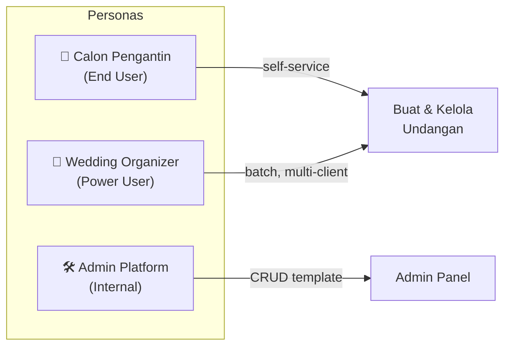
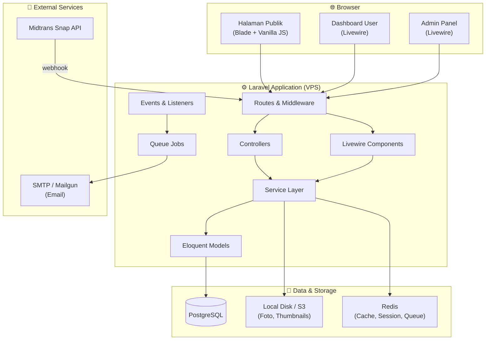
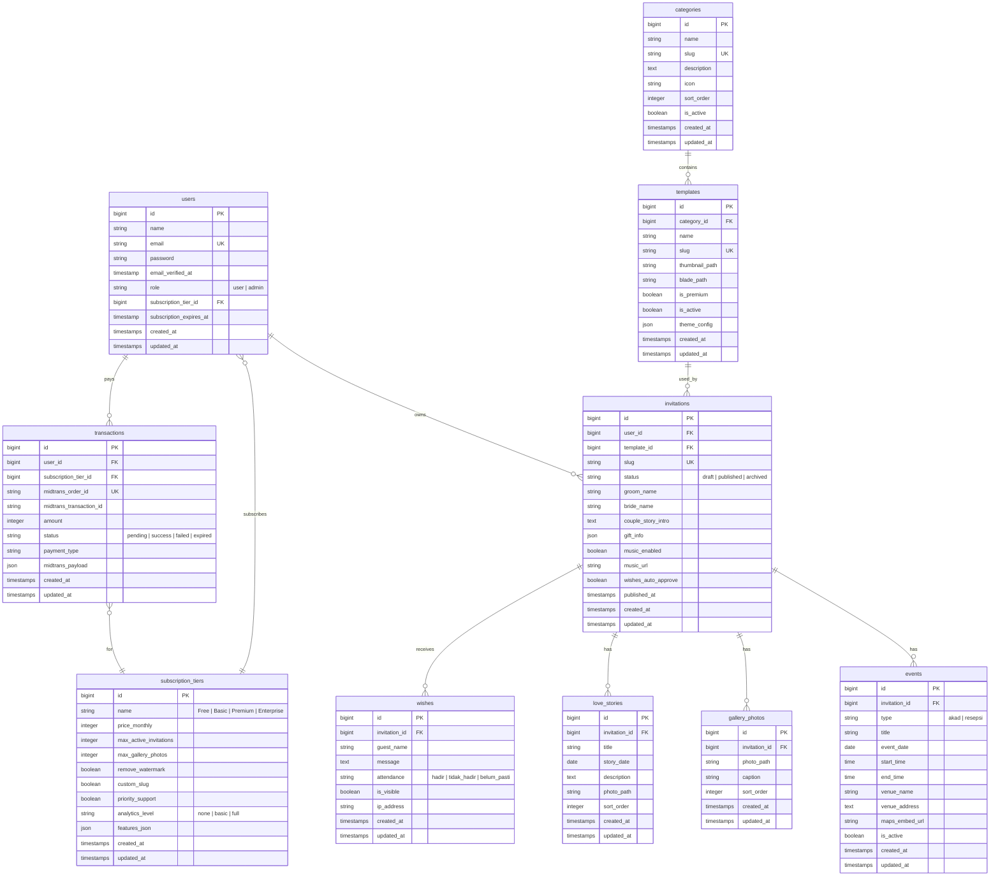
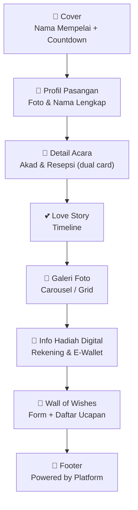
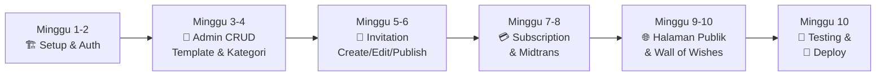

# 📋 Product Requirements Document (PRD)
## **Undangan Digital Pernikahan — Self-Service Platform**

> **Versi**: 1.1 &nbsp;|&nbsp; **Tanggal**: 20 November 2026 &nbsp;|&nbsp; **Status**: Updated — Latest Tech Stack

---

## 1. Executive Summary

### 1.1 Problem Statement

Membuat undangan pernikahan digital di Indonesia masih mahal jika lewat vendor, atau ribet jika manual. Platform yang ada sering tidak fleksibel — terlalu kaku pada template, kurang fitur kultural (akad + resepsi terpisah, info hadiah digital/transfer), dan subscription plan yang tidak transparan. Calon pengantin dan *wedding organizer* (WO) butuh solusi self-service yang cepat, cantik, dan terjangkau.

### 1.2 Proposed Solution

Platform web self-service berbasis **Laravel (versi terbaru) + Livewire 3 + Tailwind CSS 4** di mana pengguna bisa mendaftar, memilih template dari katalog, mengisi detail acara (dual-event: akad & resepsi), dan mempublikasikan undangan ke URL/slug publik. Monetisasi melalui **4-tier subscription** dengan pembayaran via **Midtrans Snap**. Admin mengelola katalog template & kategori lewat panel khusus. Setiap template membawa konfigurasi tema/warna bawaan (`themeConfig`) yang **tidak bisa di-override** end-user, menjaga konsistensi visual.

### 1.3 Success Criteria (KPI)

| # | KPI | Target (6 bulan pertama) |
|---|-----|--------------------------|
| 1 | Jumlah user terdaftar | ≥ 2.000 |
| 2 | Jumlah undangan yang di-publish | ≥ 500 |
| 3 | Conversion free → paid | ≥ 8% |
| 4 | Monthly Recurring Revenue (MRR) | ≥ Rp 15.000.000 |
| 5 | Lighthouse Performance score halaman publik | ≥ 90 |
| 6 | Rata-rata waktu dari sign-up hingga publish | ≤ 15 menit |

---

## 2. User Experience & Functionality

### 2.1 User Personas



| Persona | Deskripsi | Kebutuhan Utama |
|---------|-----------|-----------------|
| **Calon Pengantin** | Pasangan 22-35 tahun, tech-savvy, budget-conscious | Buat undangan cepat, cantik, bisa share via WhatsApp |
| **Wedding Organizer** | Vendor profesional, kelola banyak klien | Multi-undangan aktif, branding profesional, laporan |
| **Admin Platform** | Tim internal | CRUD template & kategori, monitoring user/transaksi |

### 2.2 User Stories & Acceptance Criteria

#### Module A: Authentication

| ID | User Story | Acceptance Criteria |
|----|-----------|---------------------|
| A-1 | Sebagai pengunjung, saya ingin **mendaftar dengan email & password** agar mendapat akun. | ✅ Form: nama, email, password, konfirmasi password. <br>✅ Validasi: email unik, password min 8 karakter (1 huruf besar, 1 angka). <br>✅ Setelah submit, kirim email verifikasi (link valid 60 menit). <br>✅ Akun berstatus `unverified` sampai email dikonfirmasi. |
| A-2 | Sebagai user baru, saya ingin **memverifikasi email** agar akun saya aktif. | ✅ Klik link → akun jadi `verified`, redirect ke dashboard. <br>✅ Link expired → tampil pesan + tombol "Kirim Ulang". <br>✅ Resend max 3× per jam. |
| A-3 | Sebagai user, saya ingin **sign in dengan email & password**. | ✅ Validasi kredensial, rate-limit 5 attempt / 15 menit. <br>✅ Jika `unverified`, tampilkan pesan "Verifikasi email Anda dulu" + resend link. <br>✅ Session expire: 7 hari (remember me) / 2 jam (default). |
| A-4 | Sebagai user, saya ingin **reset password** jika lupa. | ✅ Input email → kirim link reset (valid 60 menit). <br>✅ Set password baru (validasi sama dengan sign-up). <br>✅ Setelah reset, semua session aktif di-invalidate. |

#### Module B: Subscription & Payment

| ID | User Story | Acceptance Criteria |
|----|-----------|---------------------|
| B-1 | Sebagai user, saya ingin **melihat daftar tier langganan** agar bisa memilih plan. | ✅ Tampilkan 4 tier dalam tabel/kartu perbandingan. <br>✅ Highlight tier yang sedang aktif milik user. |
| B-2 | Sebagai user, saya ingin **checkout & bayar** via Midtrans Snap. | ✅ Klik "Upgrade" → Midtrans Snap pop-up muncul. <br>✅ Support metode: GoPay, QRIS, bank transfer (VA), kartu kredit. <br>✅ Setelah pembayaran sukses, tier langsung terupdate (webhook). <br>✅ Jika gagal/expired, tampilkan status + tombol retry. |
| B-3 | Sebagai user, saya ingin **melihat riwayat transaksi**. | ✅ Tabel: tanggal, tier, jumlah, status, invoice PDF. |
| B-4 | Sebagai sistem, saya harus **membatasi jumlah undangan aktif** sesuai tier user. | ✅ Jika user sudah di limit → tombol "Buat Undangan" disabled + pesan upgrade. |

**Tabel Tier:**

| Fitur | Free | Basic | Premium | Enterprise |
|-------|------|-------|---------|------------|
| Harga/bulan | Rp 0 | Rp 49.000 | Rp 99.000 | Rp 249.000 |
| Undangan aktif | 1 | 3 | 10 | Unlimited |
| Template akses | Gratis saja | Semua | Semua | Semua + Custom |
| Galeri foto | 5 foto | 15 foto | 30 foto | Unlimited |
| Hapus watermark | ❌ | ✅ | ✅ | ✅ |
| Custom domain / slug | ❌ | ❌ | ✅ | ✅ |
| Dukungan prioritas | ❌ | ❌ | ❌ | ✅ |
| Analytics tamu (views, RSVP) | ❌ | Basic | Lengkap | Lengkap + Export |

> [!NOTE]
> Harga dan limit di atas adalah rekomendasi awal. Harus di-review berdasarkan riset pasar sebelum go-live. Angka disimpan di tabel `subscription_tiers` (database-driven), bukan hard-coded.

#### Module C: Katalog Template & Manajemen Undangan

| ID | User Story | Acceptance Criteria |
|----|-----------|---------------------|
| C-1 | Sebagai user, saya ingin **browse katalog template** per kategori. | ✅ Grid view dengan thumbnail preview. <br>✅ Filter: kategori, gratis/premium. <br>✅ Pagination atau infinite scroll. |
| C-2 | Sebagai user, saya ingin **preview template** sebelum memilih. | ✅ Full-page preview (desktop & mobile viewport toggle). <br>✅ Menampilkan data dummy. |
| C-3 | Sebagai user, saya ingin **membuat undangan baru** dari template yang dipilih. | ✅ Pilih template → masuk form multi-step wizard. <br>✅ Cek limit undangan aktif sesuai tier. <br>✅ Jika template premium & user Free → tampilkan prompt upgrade. |
| C-4 | Sebagai user, saya ingin **mengedit undangan** yang sudah dibuat. | ✅ Edit semua field konten (teks, foto, tanggal, lokasi). <br>✅ **TIDAK** bisa mengubah warna/tema template (`themeConfig` locked). <br>✅ Auto-save draft setiap 30 detik. |
| C-5 | Sebagai user, saya ingin **publish undangan** ke slug publik. | ✅ Generate slug: `domain.com/{slug}` (default: `nama-mempelai`). <br>✅ User bisa custom slug (Premium+), validasi unik. <br>✅ Setelah publish, undangan bisa diakses publik. <br>✅ Tombol share ke WhatsApp, copy link. |
| C-6 | Sebagai user, saya ingin **unpublish / archive** undangan. | ✅ Unpublish → slug menampilkan halaman "Undangan tidak tersedia". <br>✅ Archive → tersimpan tapi tidak dihitung di limit aktif. |

#### Module D: Admin Panel

| ID | User Story | Acceptance Criteria |
|----|-----------|---------------------|
| D-1 | Sebagai admin, saya ingin **CRUD kategori template**. | ✅ Nama, slug, deskripsi, ikon, urutan tampil, status aktif/nonaktif. |
| D-2 | Sebagai admin, saya ingin **CRUD template**. | ✅ Upload file Blade + thumbnail + `themeConfig` JSON. <br>✅ Assign ke kategori. <br>✅ Tandai gratis/premium. <br>✅ Preview sebelum publish. |
| D-3 | Sebagai admin, saya ingin **melihat dashboard** user & transaksi. | ✅ Total users, undangan, revenue. <br>✅ Grafik pendaftaran harian & transaksi bulanan. |
| D-4 | Sebagai admin, saya ingin **mengelola user** (view, deactivate). | ✅ List user + filter (tier, status, tanggal). <br>✅ Deactivate user → semua undangan di-unpublish. |

#### Module E: Konten Undangan (Detail)

| ID | User Story | Acceptance Criteria |
|----|-----------|---------------------|
| E-1 | Sebagai user, saya ingin **mengisi detail acara ganda** (Akad & Resepsi). | ✅ Per-event: nama acara, tanggal, waktu mulai-selesai, nama tempat, alamat, embed Google Maps. <br>✅ Bisa aktifkan/nonaktifkan salah satu event. |
| E-2 | Sebagai user, saya ingin **upload galeri foto pasangan**. | ✅ Upload multiple foto (max sesuai tier). <br>✅ Compress otomatis ke WebP, max 1MB per foto. <br>✅ Reorder via drag-and-drop. |
| E-3 | Sebagai user, saya ingin **menulis Love Story** (cerita pasangan). | ✅ Timeline entries: judul, tanggal, deskripsi, foto opsional. <br>✅ Min 1, max 10 entry. |
| E-4 | Sebagai user, saya ingin **menambahkan info hadiah digital**. | ✅ Pilih metode: transfer bank (nama bank, no rek, atas nama), e-wallet (GoPay/OVO/DANA + nomor), alamat kirim fisik. <br>✅ Tampilkan tombol "Salin" di halaman publik. |
| E-5 | Sebagai user, saya ingin **countdown ke hari-H** otomatis tampil. | ✅ Countdown ke tanggal event terdekat (akad/resepsi). <br>✅ Setelah H-day, tampilkan "Acara telah berlangsung". |

#### Module F: Halaman Publik & Wall of Wishes

| ID | User Story | Acceptance Criteria |
|----|-----------|---------------------|
| F-1 | Sebagai tamu, saya ingin **melihat undangan** di halaman publik yang responsif. | ✅ Desktop-first responsive (1440px → 768px → 375px). <br>✅ Loading time ≤ 2 detik (Lighthouse Performance ≥ 90). <br>✅ Animasi scroll smooth (AOS atau native CSS). <br>✅ Background music opsional (autoplay muted, toggle on/off). |
| F-2 | Sebagai tamu, saya ingin **mengirim ucapan** (Wall of Wishes). | ✅ Form: nama, ucapan (max 500 karakter), konfirmasi kehadiran (Hadir / Tidak Hadir / Belum Pasti). <br>✅ Ucapan tampil real-time (Livewire polling 10 detik). <br>✅ Spam protection: rate-limit 1 ucapan per IP per 5 menit. <br>✅ Profanity filter dasar (kata kasar Bahasa Indonesia). |
| F-3 | Sebagai pemilik undangan, saya ingin **moderasi ucapan tamu**. | ✅ List ucapan di dashboard: approve / hide / delete. <br>✅ Default: semua ucapan langsung tampil (auto-approve). <br>✅ Setting opsional: manual approval mode. |

#### Module G: Theme Config (Locked Theming)

| ID | User Story | Acceptance Criteria |
|----|-----------|---------------------|
| G-1 | Sebagai admin, saya ingin **mendefinisikan `themeConfig`** per template. | ✅ JSON config meliputi: `primaryColor`, `secondaryColor`, `accentColor`, `fontHeading`, `fontBody`, `backgroundPattern`, `buttonStyle`. <br>✅ Disimpan di tabel `templates.theme_config` (JSON column). |
| G-2 | Sebagai sistem, saya harus **menerapkan `themeConfig`** saat render undangan. | ✅ CSS variables di-generate dari `themeConfig` di server-side. <br>✅ Tidak ada UI/form untuk user mengubah warna/font. <br>✅ Preview & published page menggunakan tema identik. |

### 2.3 Non-Goals (Fase 1 / MVP)

Berikut fitur yang **TIDAK** termasuk dalam scope MVP:

- ❌ **RSVP Management** — tracking siapa yang sudah konfirmasi (di luar Wall of Wishes).
- ❌ **Multi-bahasa** (i18n) — UI hanya Bahasa Indonesia.
- ❌ **Mobile app** (Android/iOS) — web-only.
- ❌ **AI features** — auto-generate copy, suggest template, dsb.
- ❌ **Custom domain mapping** — user tidak bisa pakai domain sendiri (hanya slug di domain utama).
- ❌ **A/B testing** template.
- ❌ **White-label** untuk WO/vendor.
- ❌ **Video undangan** / embed video.
- ❌ **Multi-currency** — hanya IDR.
- ❌ **Integrasi kalender** (Google Calendar / iCal).

---

## 3. Technical Specifications

### 3.1 Architecture Overview



### 3.2 Tech Stack

| Layer | Teknologi | Versi (Terbaru) | Catatan |
|-------|-----------|-----------------|---------|
| **Language** | PHP | 8.4+ / 8.5+ | Local Laragon running PHP 8.5.12 |
| **Framework** | Laravel | 11.x / 12.x | Versi stabil terbaru |
| **Frontend Interactivity** | Livewire | 3.x | Versi terbaru Livewire component |
| **CSS** | Tailwind CSS | 4.x | Versi terbaru Tailwind (engine baru tanpa PostCSS/Tailwind config rumit) |
| **JavaScript / Runtime** | Node.js | v22+ LTS / v26+ | Local environment running Node v26.13.1 |
| **Database** | PostgreSQL | 17+ | Versi stabil PostgreSQL terbaru |
| **Cache / Queue / Session** | Redis / Valkey | 7.4+ / 8.x | Versi terbaru |
| **Testing Framework** | Pest PHP | v3.x | Testing modern untuk Laravel |
| **Payment Gateway** | Midtrans Snap | Latest SDK / API | Snap pop-up + Server Notification Webhook |
| **Email** | SMTP / Mailgun | Latest API | Laravel Mailable & Notification |
| **File Storage** | Local disk (MVP) → S3-compatible (scale) | — | Storage driver Laravel |
| **Web Server** | Nginx | 1.26+ (Stable) | Proxy & SSL termination |
| **Process Manager** | Supervisor | Latest | Queue worker process manager |
| **Dev Environment** | Laragon (Windows) | — | PHP 8.5+, Composer 2.11+, Node.js v26+ |

### 3.3 Database Schema (Core Tables)



### 3.4 Key `themeConfig` JSON Structure

```json
{
  "primaryColor": "#8B5E3C",
  "secondaryColor": "#F5E6D3",
  "accentColor": "#D4A574",
  "fontHeading": "Playfair Display",
  "fontBody": "Lato",
  "backgroundPattern": "floral-01",
  "buttonStyle": "rounded",
  "buttonColor": "#8B5E3C",
  "buttonTextColor": "#FFFFFF",
  "sectionDivider": "wave"
}
```

Rendering flow:
1. Controller loads `invitation` → eager-loads `template.theme_config`.
2. Blade layout injects CSS custom properties from `themeConfig`:
   ```html
   <style>
     :root {
       --color-primary: {{ $theme->primaryColor }};
       --color-secondary: {{ $theme->secondaryColor }};
       --font-heading: '{{ $theme->fontHeading }}', serif;
       /* ... */
     }
   </style>
   ```
3. Template Blade files reference `var(--color-primary)` etc.
4. **No user-facing UI** exists to change these values.

### 3.5 Integration Points

| Integration | Tipe | Detail |
|-------------|------|--------|
| **Midtrans Snap** | Payment | Server-to-server: generate Snap Token via API. Client: `snap.js` pop-up. Webhook: `/api/midtrans/notification` (verify signature). |
| **SMTP / Mailgun** | Email | Verifikasi email, reset password, notifikasi pembayaran. Gunakan Laravel Notification + Mailable. |
| **Google Maps** | Embed | Iframe embed URL per event. Tidak perlu API key (embed mode). |
| **Google Fonts** | CDN | Load font dari `themeConfig.fontHeading` & `fontBody` via `<link>` tag. |

### 3.6 Security & Privacy

| Area | Implementasi |
|------|-------------|
| **Authentication** | Laravel Breeze (session-based). Bcrypt hashing. CSRF protection. |
| **Authorization** | Middleware: `auth`, `verified`, `role:admin`. Policy: user hanya bisa akses undangan miliknya. |
| **Rate Limiting** | Login: 5/15 menit. Resend email: 3/jam. Wishes: 1/IP/5 menit. API: 60/menit. |
| **Input Validation** | Form Request classes. XSS sanitization (Blade `{{ }}` auto-escape). SQL injection prevention (Eloquent parameterized). |
| **File Upload** | Validasi MIME type (image/jpeg, image/png, image/webp). Max 5MB raw → compress ke WebP ≤ 1MB. Simpan di `storage/app/public`, serve via symlink. |
| **Payment Security** | Midtrans signature verification pada webhook. Jangan simpan data kartu. HTTPS wajib. |
| **Data Privacy** | Wishes menampilkan nama saja (IP disimpan internal untuk rate-limit, tidak ditampilkan). Email user tidak pernah exposed di halaman publik. |
| **HTTPS** | Enforce via Nginx redirect + Laravel `ForceScheme`. |

---

## 4. API & Route Structure

### 4.1 Web Routes (User-Facing)

```
GET    /                           → Landing page
GET    /login                      → Login form
POST   /login                      → Authenticate
GET    /register                   → Register form
POST   /register                   → Create account
GET    /email/verify/{id}/{hash}   → Verify email
POST   /email/resend               → Resend verification
GET    /forgot-password            → Forgot password form
POST   /forgot-password            → Send reset link
GET    /reset-password/{token}     → Reset password form
POST   /reset-password             → Update password

# Dashboard (auth + verified)
GET    /dashboard                  → User dashboard
GET    /templates                  → Browse template catalog
GET    /templates/{slug}/preview   → Preview template
GET    /subscription               → View plans
POST   /subscription/checkout      → Generate Snap token
GET    /transactions               → Transaction history

# Invitation Management (auth + verified)
POST   /invitations                → Create new invitation
GET    /invitations/{id}/edit      → Edit invitation (Livewire)
POST   /invitations/{id}/publish   → Publish
POST   /invitations/{id}/unpublish → Unpublish
POST   /invitations/{id}/archive   → Archive
DELETE /invitations/{id}           → Delete

# Admin Panel (auth + role:admin)
GET    /admin/dashboard            → Admin dashboard
       /admin/categories           → CRUD categories (Livewire)
       /admin/templates            → CRUD templates (Livewire)
       /admin/users                → User management
       /admin/transactions         → Transaction list
```

### 4.2 API Routes

```
POST   /api/midtrans/notification  → Midtrans webhook (no auth, signature verify)
```

### 4.3 Public Routes (No Auth)

```
GET    /{slug}                     → Public invitation page
POST   /{slug}/wishes              → Submit wish (rate-limited)
```

> [!WARNING]
> Route `/{slug}` harus didaftarkan **terakhir** untuk menghindari conflict dengan route lain. Gunakan `where('slug', '^(?!admin|api|login|register|dashboard).*$')` atau route fallback pattern.

---

## 5. UI/UX Wireframe (High-Level)

### 5.1 Halaman Publik Undangan — Section Flow



### 5.2 Dashboard User — Navigation

```
┌──────────────────────────────────────────────┐
│  SIDEBAR                │  MAIN CONTENT       │
│  ───────                │                     │
│  📊 Dashboard           │  [Selected Page]    │
│  📨 Undangan Saya       │                     │
│  📂 Katalog Template    │                     │
│  💳 Langganan           │                     │
│  📄 Riwayat Transaksi   │                     │
│  ⚙️ Pengaturan Akun     │                     │
└──────────────────────────────────────────────┘
```

---

## 6. Risks & Mitigations

| # | Risk | Dampak | Probabilitas | Mitigasi |
|---|------|--------|-------------|----------|
| 1 | **Midtrans webhook gagal** — payment sukses tapi tier tidak update | Tinggi | Sedang | Implementasi retry mechanism di Midtrans. Cron job reconciliation setiap 1 jam (cek pending transactions > 30 menit). Manual override di admin. |
| 2 | **Slug collision** — dua user ingin slug yang sama | Sedang | Tinggi | Validasi unik di database (unique index). Suggest alternatif otomatis (`slug-2`, `slug-3`). |
| 3 | **Storage penuh** — banyak foto upload | Tinggi | Sedang | Compress agresif ke WebP. Limit per tier. Monitoring disk usage. Migrasi ke S3-compatible saat ≥ 50GB. |
| 4 | **Spam wishes** — bot mengisi Wall of Wishes | Sedang | Tinggi | Rate-limit per IP. Honeypot field. Profanity filter. Opsional: approval mode. |
| 5 | **Template Blade injection** — admin upload template berbahaya | Tinggi | Rendah | Validasi Blade file saat upload. Sandbox rendering. Hanya admin terpercaya yang punya akses. |
| 6 | **Performa halaman publik** — banyak foto/wishes membuat lambat | Sedang | Sedang | Lazy-load gambar. Pagination wishes (10 per batch). Redis cache halaman publik (TTL 5 menit, invalidate saat ada wish baru). |
| 7 | **VPS single point of failure** | Tinggi | Sedang | Daily automated backup (DB + storage). Monitoring uptime (UptimeRobot). Rencana migrasi ke managed hosting jika scale. |

---

## 7. Phased Rollout / Roadmap

### Phase 1: MVP (Target: 8-10 minggu)



**Deliverables MVP:**
- ✅ Auth lengkap (register, verify, login, forgot password)
- ✅ Admin panel CRUD template & kategori
- ✅ User buat/edit/publish undangan
- ✅ 4-tier subscription + Midtrans Snap
- ✅ Halaman publik responsif + Wall of Wishes
- ✅ Countdown, galeri, love story, info hadiah, dual event
- ✅ themeConfig locked per template
- ✅ 3-5 template bawaan (seed)

### Phase 2: Growth (v1.1 — bulan ke-4)

- 📊 Analytics tamu (views, unique visitors, RSVP summary)
- 🔗 Custom domain mapping (Premium+)
- 📧 Blast undangan via WhatsApp / email (integration)
- 🎵 Background music library
- 📱 PWA support (install ke home screen)

### Phase 3: Scale (v2.0 — bulan ke-8)

- 🤖 AI features: auto-generate copy undangan, suggest template
- 🌐 Multi-bahasa (ID + EN)
- 🎥 Video section (embed YouTube/TikTok)
- 📅 Integrasi Google Calendar
- 🏷️ White-label untuk WO (branding sendiri)
- 📦 Migrasi storage ke S3
- ☁️ Migrasi infrastruktur ke managed hosting / cloud

---

## 8. Testing Strategy

| Tipe | Scope | Tool |
|------|-------|------|
| **Unit Test** | Models, Services, ThemeConfig rendering | PHPUnit / Pest |
| **Feature Test** | Auth flow, invitation CRUD, subscription checkout, webhook handling | Pest + Laravel HTTP tests |
| **Browser Test** | Full user journey: register → create invitation → publish → view public page | Laravel Dusk |
| **Performance** | Halaman publik load time, Lighthouse score | Lighthouse CI, `ab` (Apache Bench) |
| **Security** | SQL injection, XSS, CSRF, file upload validation, rate-limit bypass | Manual pen-test + automated scan (OWASP ZAP) |
| **Payment** | Midtrans sandbox: success, pending, failed, expired scenarios | Midtrans Sandbox environment |

> [!IMPORTANT]
> Semua test payment **WAJIB** menggunakan Midtrans Sandbox environment selama development. Jangan pernah test dengan production credentials.

---

## 9. Definition of Done (Global)

Sebuah fitur dianggap **selesai** jika memenuhi semua kriteria:

- [ ] Semua Acceptance Criteria pada user story terpenuhi
- [ ] Unit test & feature test tertulis dan passing
- [ ] Tidak ada error di `php artisan test`
- [ ] Code di-review (jika tim > 1 orang)
- [ ] Responsif di viewport 375px, 768px, 1440px
- [ ] Lighthouse Accessibility score ≥ 90
- [ ] Tidak ada `dd()`, `dump()`, atau `console.log()` tertinggal
- [ ] Migration & seeder berjalan clean dari nol (`migrate:fresh --seed`)

---

> [!TIP]
> **Langkah Selanjutnya yang Disarankan:**
> 1. Review dan finalisasi tabel tier (harga & limit) berdasarkan riset kompetitor.
> 2. Desain 3-5 template awal (Blade + themeConfig).
> 3. Setup project Laravel + migrasi database sesuai schema di atas.
> 4. Mulai development Phase 1 dari Module A (Auth).
